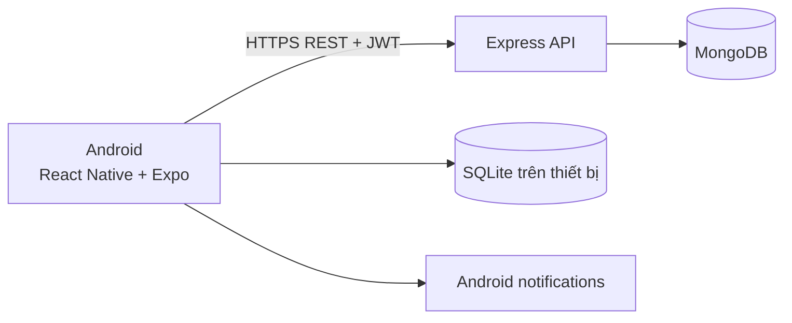
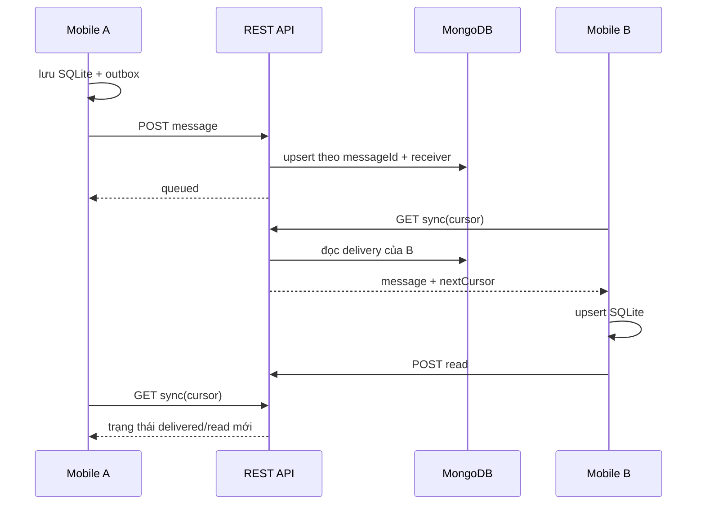

# Kiến trúc Student Planner

## Tổng quan

Hệ thống chỉ có hai tiến trình ứng dụng: Mobile và API. MongoDB giữ dữ liệu dùng chung; SQLite giữ dữ liệu cần mở lại nhanh hoặc cần xếp hàng khi mất mạng. Không có signaling, relay Socket.IO, WebRTC hay server presence trong repository này.

## Ranh giới module

### `src/mobile`

- `screens/`: màn hình cấp cao và điều hướng theo state.
- `components/`: UI lịch, task, dự án, thảo luận và chat.
- `hooks/`: điều phối state và luồng nghiệp vụ của màn hình.
- `services/api.ts`: mọi request HTTP, token và chuyển đổi response.
- `services/local.ts`: SQLite, outbox chat, cursor đồng bộ và reminder.
- `domain/`: kiểu và chính sách thuần, có thể test không cần React Native.
- `types/`: kiểu dữ liệu API dùng chung trong Mobile.

UI không truy cập MongoDB. API service không điều khiển component. Chính sách quyền hiển thị trong Mobile chỉ phục vụ trải nghiệm; API luôn kiểm tra lại quyền.

### `src/api`

- `index.ts`: composition root, auth, task/event/project routes và khởi động server.
- `models.ts`: schema/index Mongoose.
- `projectAccess.ts`: vai trò và quyền dự án.
- `projectRoutes.ts`: membership, phân cấp, archive, tiến độ và nguồn lực.
- `discussionRoutes.ts`: bài, bình luận và attachment thảo luận.
- `chatPersistenceRoutes.ts`: endpoint store-and-forward, sync, read và attachment chat.
- `chatPersistenceService.ts`: kiểm tra message, fan-out nhóm, cursor và delivery state.
- `directChatRoutes.ts` / `directChatService.ts`: tìm user, block và ẩn hội thoại.
- `notifications.ts`: hộp thư thông báo dự án/task/thảo luận.

## Dữ liệu chính

- `users`: tài khoản và password hash.
- `projects`: dự án tổng/con, owner/manager, membership cache, archive, version, nguồn lực.
- `project_members`: vai trò theo từng dự án; user không có vai trò toàn cục.
- `tasks`, `events`: công việc và lịch.
- `discussions`, `comments`, `documents`: nội dung lâu dài và metadata tệp.
- `notifications`: hộp thư trong ứng dụng.
- `chat_messages`: một record delivery cho mỗi người nhận.
- `chat_attachments`: metadata và `gridFsFileId`; bytes nằm trong `uploads.files/uploads.chunks` của GridFS.
- `user_blocks`: quan hệ chặn có hướng.

Các thao tác thay đổi membership/manager/task liên quan dùng MongoDB transaction, vì vậy Mongo local cần replica set.

## Chat offline

Message ID làm khóa chống lặp khi outbox retry. Chat nhóm fan-out một delivery cho từng thành viên hiện hành. Khi user bị loại khỏi dự án, API không trả tin nhóm mới cho họ; lịch sử SQLite cũ vẫn còn trên thiết bị. Polling chạy khi app mở, hiện chưa có push/background sync bảo đảm.

## Lịch và nhắc việc

Task và event nằm trong MongoDB. Mobile tổng hợp chúng thành lịch ngày/tuần/tháng. Lịch nhắc được tạo bằng `expo-notifications` và ID notification lưu SQLite; khi deadline đổi hoặc mục hoàn thành/xóa, reminder cũ được hủy rồi lập lại.

Google Calendar không còn là integration runtime. Nếu phát triển lại, OAuth credential phải nằm ngoài repository và cần định nghĩa rõ chiều đồng bộ, khóa chống trùng, xóa và giải quyết xung đột.

## Bảo mật

- JWT xác định user; client không được tự khai sender của message.
- Password lưu bằng bcrypt hash.
- Zod giới hạn trường, kiểu và độ dài payload.
- API kiểm tra membership/role trước mọi dữ liệu dự án, chat nhóm và tệp.
- Attachment tối đa 5 MiB/tệp, tối đa 3 tệp/lần; upload dùng tệp tạm trên API rồi stream vào GridFS, quyền tải được kiểm tra lại.
- Mobile cache tệp theo tài khoản trong thư mục riêng, xác minh kích thước, theo dõi LRU bằng SQLite và tự dọn khi vượt 200 MiB.
- Block được kiểm tra server-side, không chỉ khóa nút ở Mobile.
- `MONGO_URL` và `JWT_SECRET` chỉ ở server `.env`, không dùng tiền tố Expo public.

## Chạy local và Internet

Local dùng API `:4000`, MongoDB `:27017` và Metro `:8081`. Emulator truy cập host qua `10.0.2.2`. Khi hai thiết bị không cùng mạng, đưa API ra HTTPS bằng reverse proxy/tunnel rồi build app với `EXPO_PUBLIC_API_URL` tương ứng. Caddy mẫu chỉ expose API; MongoDB không nên mở trực tiếp ra Internet.

## Giới hạn kiến trúc

- Polling 3 giây phù hợp bài tập, không tối ưu pin/băng thông cho sản phẩm lớn.
- Attachment bytes trong MongoDB chỉ phù hợp tệp nhỏ.
- Không có E2EE; server đọc được nội dung.
- `newArchEnabled` hiện tắt để giữ build ổn định; cần đánh giá lại khi nâng Expo/React Native.
